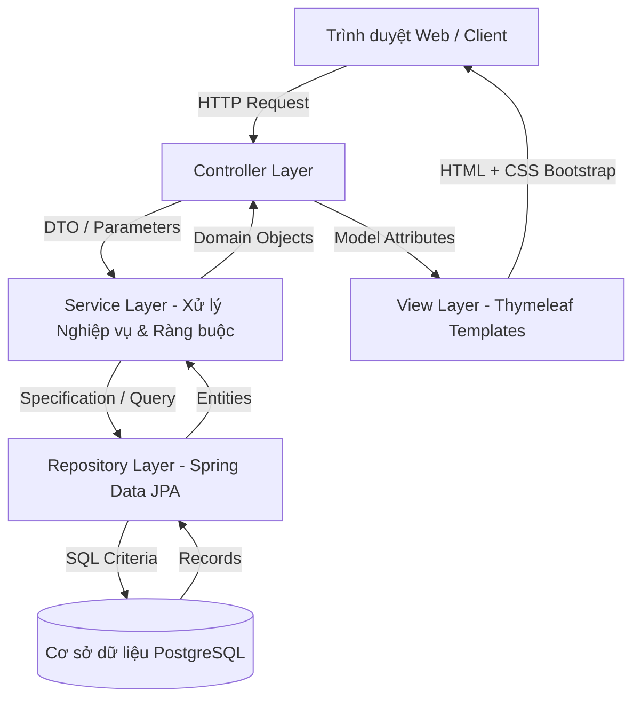
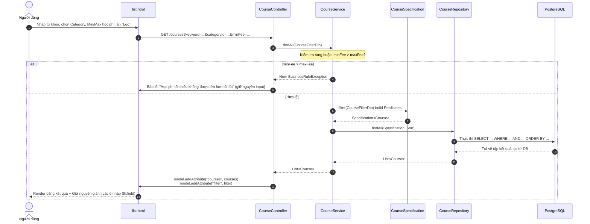
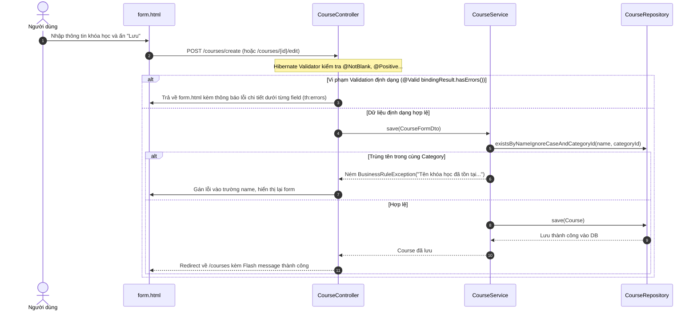
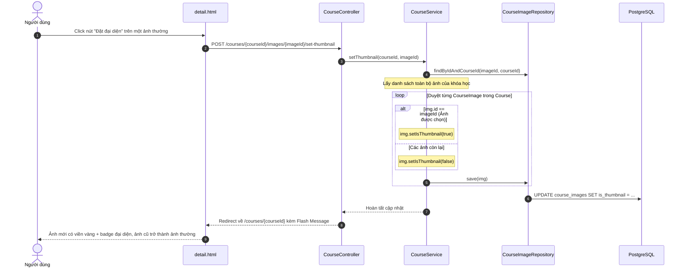
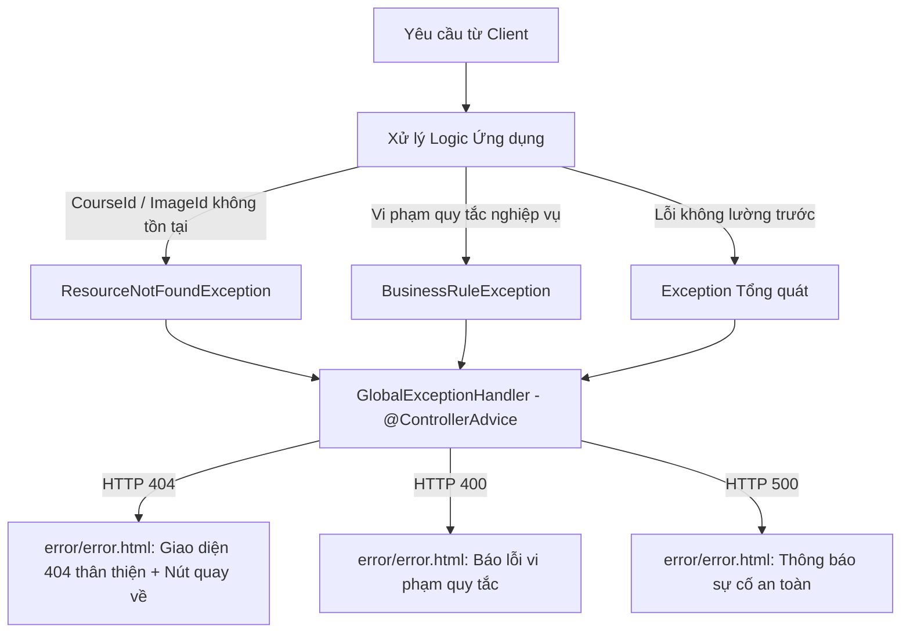

# TÀI LIỆU HƯỚNG DẪN LUỒNG HOẠT ĐỘNG TOÀN BỘ HỆ THỐNG
## DỰ ÁN: QUẢN LÝ KHÓA HỌC (SPRING BOOT MVC + JPA + THYMELEAF)

Tài liệu này giải thích chi tiết luồng dữ liệu (Data Flow) và cách các tầng **Controller - Service - Repository - Entity - View (Thymeleaf)** phối hợp với nhau cho từng tính năng theo yêu cầu đề bài. Bạn có thể sử dụng tài liệu này để thuyết trình hoặc trả lời vấn đáp với giảng viên.

---

## 📌 MỤC LỤC
1. [Kiến trúc Tổng quan (Architectural Flow)](#1-kiến-trúc-tổng-quan)
2. [Luồng Khởi tạo & Seed Dữ liệu (DataInitializer)](#2-luồng-khởi-tạo--seed-dữ-liệu-datainitializer)
3. [Luồng Chức năng: Danh sách, Tra cứu & Lọc bằng Specification](#3-luồng-danh-sách-tra-cứu--lọc-specification)
4. [Luồng Chức năng: Phân loại Thời lượng (Trường tính toán)](#4-luồng-phân-loại-thời-lượng-trường-tính-toán)
5. [Luồng Chức năng: Thêm mới & Chỉnh sửa Khóa học (Validation)](#5-luồng-thêm-mới--chỉnh-sửa-khóa-học-validation)
6. [Luồng Chức năng: Quản lý Ảnh & Chuyển đổi Thumbnail](#6-luồng-quản-lý-ảnh--chuyển-đổi-thumbnail)
7. [Luồng Ràng buộc Nghiệp vụ: Chặn xóa Loại khóa học](#7-luồng-ràng-buộc-nghiệp-vụ-chặn-xóa-loại-khóa-học)
8. [Luồng Xử lý Lỗi Tập trung (Global Exception Handling)](#8-luồng-xử-lý-lỗi-tập-trung-global-exception-handling)

---

## 1. Kiến trúc Tổng quan

Ứng dụng tuân theo mô hình **Layered Architecture chuẩn Spring Boot**:



---

## 2. Luồng Khởi tạo & Seed Dữ liệu (DataInitializer)

### Mục đích:
Tự động chuẩn bị sẵn tối thiểu 3 danh mục và 5 khóa học kèm ảnh để demo ngay khi khởi động mà không cần nhập tay.

### Các bước hoạt động:
1. Khi ứng dụng Spring Boot vừa khởi động xong, Spring quét component và thực thi interface `CommandLineRunner` trong file `DataInitializer.java`.
2. Phương thức `categoryRepository.count()` kiểm tra DB:
   - Nếu đã có dữ liệu -> Bỏ qua.
   - Nếu rỗng -> Bắt đầu tạo mới.
3. Tạo 3 danh mục chính: *Lập trình Web*, *Khoa học Dữ liệu & AI*, *Lập trình Di động* và 1 danh mục rỗng *Kiểm thử Phần mềm (QA/QC)* (dùng để test xóa thành công).
4. Tạo 5 khóa học gắn liền với các danh mục trên, thiết lập ảnh đại diện `isThumbnail = true` và các ảnh phụ `isThumbnail = false`.
5. Đặt ít nhất một khóa học có `isActive = false` để sẵn sàng demo ràng buộc hiển thị "Ngừng tuyển sinh".

---

## 3. Luồng Danh sách, Tra cứu & Lọc (Specification)

### Mục đích:
Hỗ trợ tìm kiếm theo tên, loại, trạng thái, min/max học phí và sắp xếp. Lọc **100% trực tiếp dưới Database** qua JPA Criteria API (không lấy toàn bộ về rồi dùng vòng lặp Java). Sau khi lọc, giữ nguyên các giá trị trên form.

### Sơ đồ luồng:


### Điểm kỹ thuật cốt lõi:
- **Lọc tại Database**: Class `CourseSpecification` sử dụng `CriteriaBuilder` để nối các `Predicate` (`cb.like`, `cb.equal`, `cb.greaterThanOrEqualTo`, `cb.lessThanOrEqualTo`). Hibernate dịch trực tiếp thành các mệnh đề `WHERE` trong câu SQL gửi sang PostgreSQL.
- **Giữ lại giá trị trên Form**: Trong `CourseController`, nhận tham số qua `@ModelAttribute("filter") CourseFilterDto filter`. Trên `list.html`, form sử dụng `th:object="${filter}"` và các thẻ `th:field="*{keyword}"`, `th:field="*{categoryId}"`... Spring Form Tag sẽ tự động bind ngược lại giá trị vừa gửi lên vào các ô input.

---

## 4. Luồng Phân loại Thời lượng (Trường tính toán)

### Mục đích:
Hiển thị phân loại thời lượng khóa học:
- **Ngắn hạn**: `Duration <= 30` giờ.
- **Dài hạn**: `Duration > 30` giờ.
- **Yêu cầu đề bài**: Không tạo thêm cột trong Database.

### Cách hoạt động:
1. Trong Entity `Course.java`, định nghĩa hàm:
   ```java
   @Transient
   public String getDurationType() {
       if (duration == null) return "Chưa xác định";
       return duration <= 30 ? "Ngắn hạn" : "Dài hạn";
   }
   ```
2. Annotation `@Transient` chỉ dẫn Hibernate **bỏ qua trường này**, không tạo cột `duration_type` trong bảng `courses`.
3. Khi Thymeleaf duyệt danh sách trong `list.html` bằng cú pháp:
   ```html
   <span th:if="${course.durationType == 'Ngắn hạn'}" class="badge badge-short-term">Ngắn hạn (≤ 30h)</span>
   ```
   Thymeleaf gọi trực tiếp getter `getDurationType()` trên đối tượng Java tại thời điểm hiển thị ra màn hình.

---

## 5. Luồng Thêm mới & Chỉnh sửa Khóa học (Validation)

### Mục đích:
Thêm mới/cập nhật khóa học với đầy đủ validation: Tên không để trống, học phí > 0, thời lượng > 0, CategoryId phải tồn tại, **tên khóa học không trùng trong cùng loại**.

### Sơ đồ luồng:


---

## 6. Luồng Quản lý Ảnh & Chuyển đổi Thumbnail

### Mục đích:
- Thêm ảnh bằng URL.
- Xem bộ sưu tập ảnh tại trang Detail.
- Đổi ảnh đại diện: **Đảm bảo luôn có duy nhất 1 ảnh đại diện** tại một thời điểm. Khi chọn ảnh mới, ảnh cũ tự động chuyển thành ảnh thường.

### Sơ đồ chuyển đổi ảnh đại diện (`POST /courses/{id}/images/{imageId}/set-thumbnail`):


---

## 7. Luồng Ràng buộc Nghiệp vụ: Chặn xóa Loại khóa học

### Mục đích:
Đáp ứng **Ràng buộc 1**: Không cho phép xóa một `CourseCategory` nếu vẫn còn khóa học thuộc loại đó (ví dụ loại "Lập trình Web" đang có khóa học thì không được xóa).

### Cách xử lý:
1. Người dùng bấm nút **Xóa** loại khóa học trên trang danh mục (`POST /categories/{id}/delete`).
2. Controller gọi `categoryService.delete(id)`.
3. Trong `CourseCategoryService`:
   ```java
   if (courseRepository.existsByCategoryId(id)) {
       throw new BusinessRuleException(
           "Không được phép xóa loại khóa học '" + category.getName() + 
           "' vì hiện tại vẫn còn các khóa học đang thuộc loại này!"
       );
   }
   categoryRepository.delete(category);
   ```
4. Khi phát hiện category đang có khóa học:
   - Hệ thống chặn câu lệnh `DELETE`, ném ra `BusinessRuleException`.
   - `CourseCategoryController` bắt ngoại lệ này và chuyển thành thông báo lỗi màu đỏ (`errorMessage`) hiển thị trên giao diện người dùng.
   - Dữ liệu hoàn toàn an toàn, tính toàn vẹn của database được bảo toàn.

---

## 8. Luồng Xử lý Lỗi Tập trung (Global Exception Handling)

### Mục đích:
Bảo vệ ứng dụng trước các tình huống bất thường, đảm bảo **tuyệt đối không hiển thị trang lỗi hệ thống 500 hay WhiteLabel Error Page** ra màn hình.

### Cơ chế hoạt động:



### Các trường hợp cụ thể:
| Trường hợp lỗi | Cách hệ thống xử lý | Kết quả hiển thị |
|:---|:---|:---|
| **Truy cập `CourseId` không tồn tại** (ví dụ `/courses/99999`) | `courseService.findById()` ném `ResourceNotFoundException`. Handler bắt lỗi, thiết lập HTTP Status 404. | Hiển thị màn hình lỗi 404 chuyên nghiệp kèm nút quay về danh sách. |
| **Học phí Min > Max** | `CourseService` kiểm tra `filter.getMinFee() > filter.getMaxFee()`, ném `BusinessRuleException`. | Bắt lỗi trực tiếp tại Controller, render cảnh báo vàng trên bảng lọc, không xóa dữ liệu người dùng vừa nhập. |
| **Dữ liệu Create/Edit không hợp lệ** | `@Valid` kích hoạt Spring `BindingResult`. | Không lưu DB, quay lại form và tô đỏ các trường lỗi kèm thông điệp chi tiết. |
| **Khóa học chưa có ảnh** | Kiểm tra `course.images.isEmpty()`. | Hiển thị thông báo khuyến khích thêm ảnh và sử dụng ảnh placeholder mặc định, không làm sập giao diện. |

---

## 9. Tóm tắt các File trọng tâm cần giải thích với Giảng viên

1. **Entity**: [Course.java](file:///d:/monhoc/laptrinhweb/baituan1/BTtuan5/src/main/java/com/example/coursemanagement/entity/Course.java) -> Chỉ ra `@Transient` cho `getDurationType()` và `UniqueConstraint` cho cặp category_id + name.
2. **Specification**: [CourseSpecification.java](file:///d:/monhoc/laptrinhweb/baituan1/BTtuan5/src/main/java/com/example/coursemanagement/repository/CourseSpecification.java) -> Giải thích cách xây dựng JPA Criteria API để lọc ở DB.
3. **Nghiệp vụ Thumbnail & Category**: [CourseService.java](file:///d:/monhoc/laptrinhweb/baituan1/BTtuan5/src/main/java/com/example/coursemanagement/service/CourseService.java) và [CourseCategoryService.java](file:///d:/monhoc/laptrinhweb/baituan1/BTtuan5/src/main/java/com/example/coursemanagement/service/CourseCategoryService.java) -> Cơ chế vòng lặp đổi cờ `isThumbnail` và kiểm tra `existsByCategoryId`.
4. **Bắt lỗi**: [GlobalExceptionHandler.java](file:///d:/monhoc/laptrinhweb/baituan1/BTtuan5/src/main/java/com/example/coursemanagement/exception/GlobalExceptionHandler.java) -> `@ControllerAdvice` xử lý 404/400/500 an toàn.
